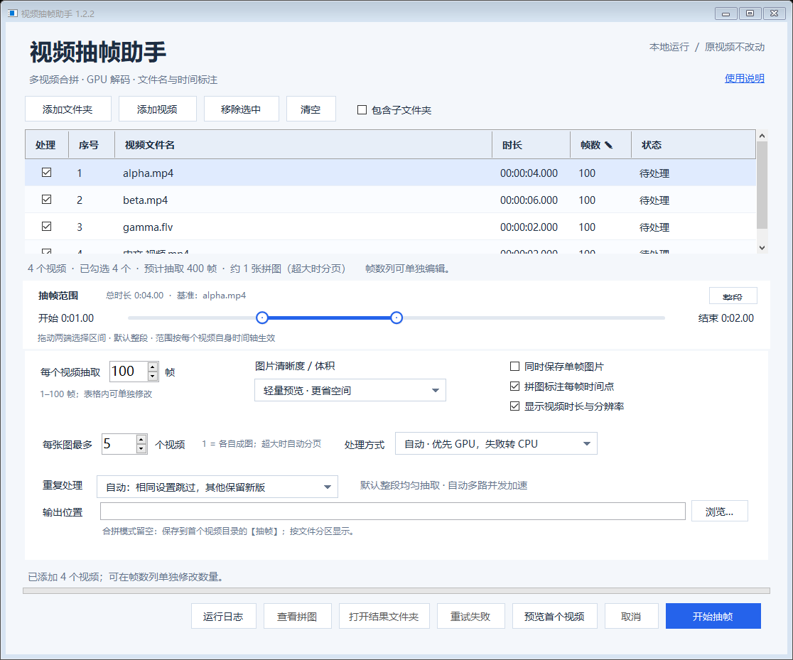

# 视频抽帧助手

> 面向课程录像、访谈、监控和长视频素材的 Windows 批量抽帧与拼图工具。

视频抽帧助手可以把一个或多个视频按指定时间区间均匀抽帧，自动生成带时间点和视频信息的拼图，也可以同时保留单帧图片。它只有一个 exe，内置视频处理组件，复制到其他 Windows 电脑即可使用。

当前版本：**1.2.2**



## 功能特点

- **批量处理**：拖入视频、选择文件夹或递归扫描子文件夹，一次处理多个视频。
- **自动读取时长**：添加视频后自动读取总时长，不需要手动查视频长度。
- **可视化时间区间**：拖动双端滑块选择开始/结束时间，默认整段；点“整段”一键恢复全片。
- **按视频独立生效**：滑块以当前选中视频为基准，范围按每个视频自己的时间轴计算；勾选的视频短于开始时间时会明确提示。
- **拼图与单帧**：支持每张图合拼多个视频、自动分页、标注时间点、显示视频时长和分辨率，也可同时保存单帧图片。
- **GPU / CPU 自动选择**：自动尝试 CUDA、D3D11VA、CPU，某个方式不可用时自动回退；也可手动固定处理方式。
- **多路并发抽帧**：每 8 帧合并到一个 ffmpeg 进程，最多 3 路并发，减少进程启动开销；低核心电脑自动降低并发。
- **避免重复处理**：相同视频、相同设置且结果完整时会自动跳过；旧结果缓存会按输出目录隔离保存。
- **输出目录干净**：输出目录只保留拼图和单帧图片，不再生成“记录”文件夹；缓存、清单和批次报告统一保存在用户数据目录。
- **单文件便携**：内置 ffmpeg，无需安装 ffmpeg、CUDA Toolkit 或管理员权限；设置和缓存不随 exe 迁移。
- **命令行批处理**：支持 `--batch`、时间区间、清晰度、合拼、报告等参数，方便自动化。

## 下载与运行

直接下载仓库中的可执行文件：

[下载 VideoFrameHelper-1.2.2.exe](dist/VideoFrameHelper-1.2.2.exe)

文件大小约 24.7 MB。SHA-256：

```text
626551e888b602db1d48e6c0c7bac00f50a749e21d06b566429e6eea643c153d
```

运行要求：

- Windows 10 / 11 x64
- .NET Framework 4.7.2 或更高（Windows 10/11 通常已自带）
- 可选：支持 CUDA 或 D3D11VA 的显卡；没有 GPU 时会自动使用 CPU
- 无需安装，无需管理员权限

首次运行时，程序会把内置的 ffmpeg 校验并解压到：

```text
%LOCALAPPDATA%\VideoFrameHelper\tools
```

程序没有代码签名，Windows SmartScreen 可能会提示“未知发布者”。确认文件来源后选择“更多信息 → 仍要运行”。

## 快速开始

1. 打开 `VideoFrameHelper-1.2.2.exe`。
2. 点击“添加视频”或“添加文件夹”，也可以直接把视频/文件夹拖进窗口。
3. 等待列表中的“时长”读取完成。
4. 在“抽帧范围”里拖动两个圆点选择区间；不拖动就是整段视频。
5. 设置每个视频抽取的帧数（1–100，可在表格中单独修改某个视频）。
6. 根据需要设置图片清晰度、每张图合拼的视频数、重复处理方式。
7. 点击“预览首个视频”检查效果，或直接点击“开始抽帧”。

输出位置留空时，拼图会保存到视频所在目录下的 `抽帧` 文件夹；填写输出位置时，所有结果保存到该目录。输出目录只包含图片，不包含内部缓存文件。

## 时间区间

- 添加视频后会自动读取总时长，并显示在列表和“抽帧范围”面板中。
- 两个圆点分别控制开始和结束时间；拖动时上方会实时显示时间。
- 点“整段”恢复全片。
- 时间范围是绝对时间：例如选中一个 6 分钟的视频，设置 1:00–2:00，就是每个视频自身时间轴上的第 1–2 分钟。勾选的其他视频如果更短，会在开始前给出提示。
- 滑块支持键盘微调：左右方向键移动当前圆点，`Shift` 加速，`Ctrl` 减速。

## 命令行

```bat
VideoFrameHelper-1.2.2.exe --batch ^
  --input "D:\videos" ^
  --output "D:\frames" ^
  --frames 50 ^
  --start 00:01:00 ^
  --end 00:05:00 ^
  --preset light ^
  --files-per-sheet 5 ^
  --acceleration auto ^
  --recursive ^
  --report "D:\frames\report.json"
```

查看全部参数：

```bat
VideoFrameHelper-1.2.2.exe --batch --help
```

主要参数：

| 参数 | 说明 |
| --- | --- |
| `--input <文件或文件夹>` | 输入视频或文件夹，可重复使用 |
| `--output <文件夹>` | 输出目录；省略时保存到视频旁的 `抽帧` |
| `--frames <1-100>` | 每个视频抽取的帧数，默认 5 |
| `--start <时间>` | 开始时间，支持秒、分:秒、时:分:秒 |
| `--end <时间>` | 结束时间，默认到视频结尾 |
| `--files-per-sheet <1-100>` | 每张拼图包含的视频数，默认 1 |
| `--preset light\|standard\|high` | 图片清晰度 |
| `--existing auto\|version\|replace` | 重复处理方式 |
| `--acceleration auto\|cuda\|d3d11va\|cpu` | 处理方式 |
| `--recursive` | 递归扫描子文件夹 |
| `--save-frames` | 同时保存单帧图片 |
| `--report <json路径>` | 写入批次报告 |

## 性能说明

1.2.2 把逐帧启动 ffmpeg 改成了多帧批量并发：每 8 帧一个进程，最多 3 路同时运行。下面的数据来自本机测试（20 线程 CPU、RTX 2060、60 秒 1080p H.264 素材、抽取 50 帧），仅用于说明优化方向，不代表所有素材：

| 版本 / 方式 | 耗时 |
| --- | --- |
| 1.2.1 自动 GPU | 27.7 s |
| 1.2.1 仅 CPU | 13.1 s |
| 1.2.2 自动 GPU | 11.1 s |
| 1.2.2 仅 CPU | 7.1 s |

对于抽帧这种“只取少量时间点”的场景，进程启动开销往往比解码本身更明显。并发数没有开到最大，而是在 3 路附近取得较稳定的结果；更多进程会被磁盘和 GPU 争抢拖慢。

> 在这台测试机上，1080p 素材使用“仅使用 CPU”反而比自动 GPU 更快；4K 素材也建议实际对比后在“处理方式”中选择。程序不会因此改变你的设置。

## 技术实现

- C# WinForms，目标框架 .NET Framework 4.7.2，单 exe 分发。
- `VideoEngine`：视频探测、抽帧、解码回退、拼图、缓存、CSV/JSON 报告和取消处理。
- `RangeSlider`：自绘的双端滑块，支持鼠标拖动和键盘微调。
- 内置 ffmpeg 以 `FrameHelper.ffmpeg.gz` 资源嵌入，首次运行时校验 SHA-256 后解压，避免依赖系统 ffmpeg。
- 抽帧结果使用临时目录 + 原子写入，取消时不会留下半成品拼图。
- 缓存记录和批次清单保存在 `%LOCALAPPDATA%\VideoFrameHelper\records`，输出目录保持干净。
- 旧版本输出目录中的“记录”文件夹会在下次处理该目录时自动迁移到上述位置并移除；如果其中还有用户自己的文件，则保留文件夹。

## 目录结构

```text
video-frame-helper/
├─ dist/
│  └─ VideoFrameHelper-1.2.2.exe
├─ docs/
│  └─ screenshot.png
├─ licenses/
│  └─ GPL-3.0.txt
├─ src/
│  ├─ FrameHelper/
│  ├─ Properties/
│  ├─ FrameHelper.ffmpeg.gz
│  ├─ VideoFrameHelper.csproj
│  ├─ app.ico
│  └─ app.manifest
├─ CHANGELOG.md
├─ THIRD_PARTY_NOTICES.md
└─ README.md
```

## 构建

仓库包含完整的 C# 源码和嵌入资源。使用 Visual Studio 2022 的“.NET 桌面开发”工作负载，并安装 .NET Framework 4.7.2 targeting pack：

1. 打开 `src/VideoFrameHelper.csproj`。
2. 选择 Release / Any CPU。
3. 生成后得到 `bin/Release/net472/视频抽帧助手.exe`。

`src/FrameHelper.ffmpeg.gz` 是内置视频组件，构建时必须保留；它会被嵌入 exe，程序运行时不依赖外部 ffmpeg。

## 隐私

视频仅在本机处理，不会上传到网络。程序不收集使用信息，也不需要联网；只有你主动使用网络路径（例如 NAS）时，文件读写才会经过对应网络位置。

## 第三方组件

程序内置 FFmpeg 5.0.1（GPLv3 构建）用于解码、缩放和抽帧。FFmpeg 是独立第三方组件，其许可、构建来源和源码获取方式见 [THIRD_PARTY_NOTICES.md](THIRD_PARTY_NOTICES.md)。FFmpeg 是 Fabrice Bellard 发起的项目商标；本项目与 FFmpeg 官方无隶属关系。

## 版本记录

见 [CHANGELOG.md](CHANGELOG.md)。

## 版权与许可

本仓库的应用代码目前未附带开源许可证，默认保留所有权利；你可以查看、下载和运行发布的可执行文件，如需复用源码请联系作者。内置 FFmpeg 遵循其自身的 GPLv3 许可，详见第三方组件说明。如果希望以 MIT 或 GPLv3 等方式开源，可以在仓库中补充 `LICENSE`。
